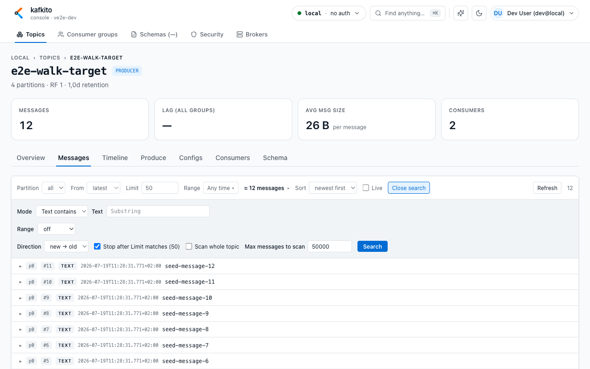
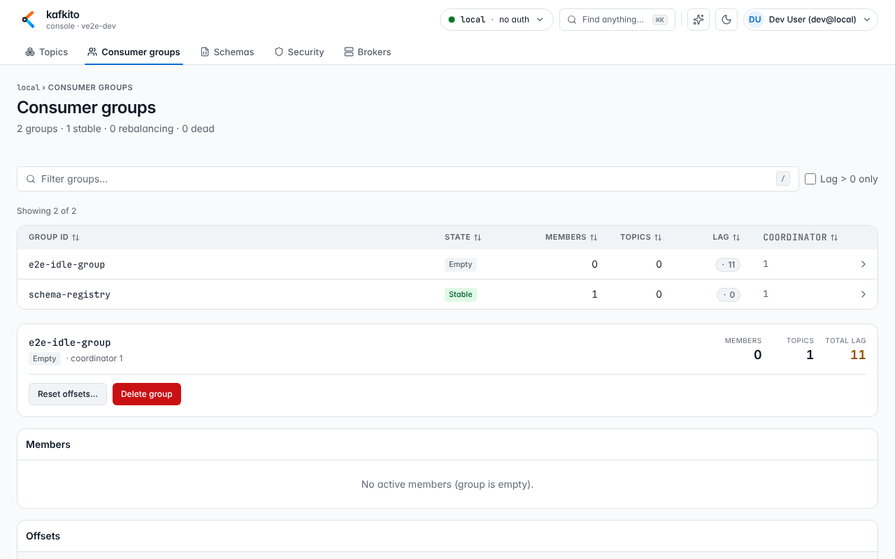
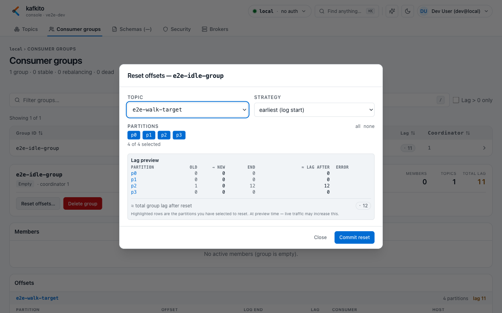
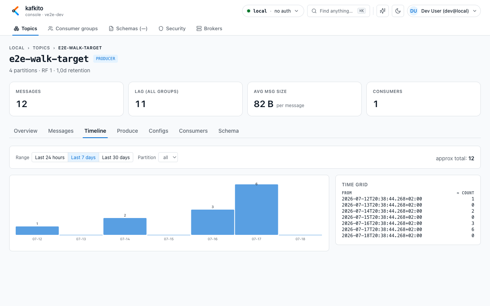
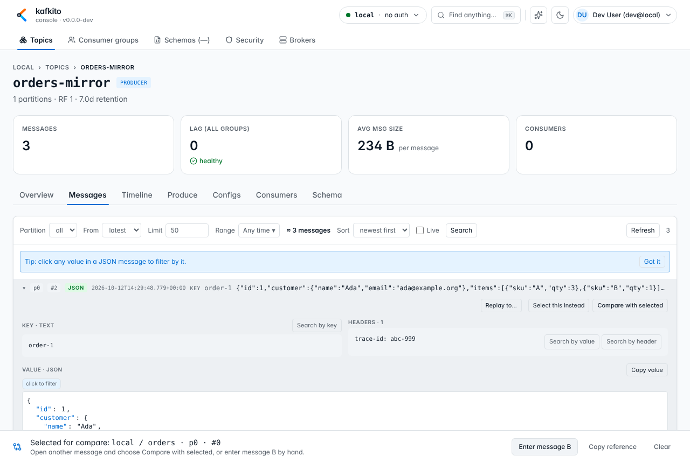
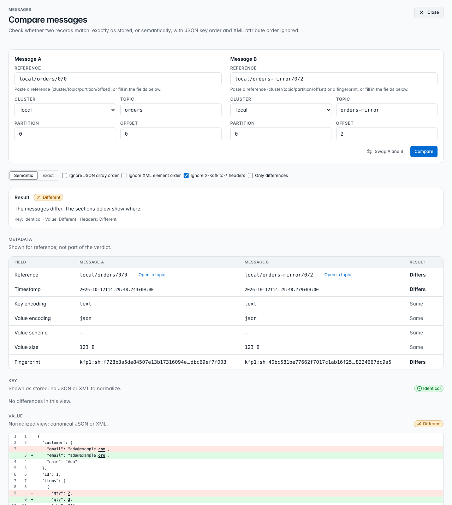
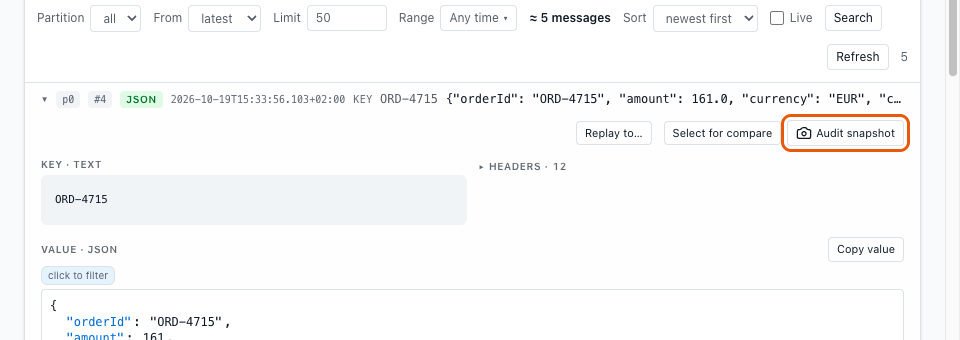
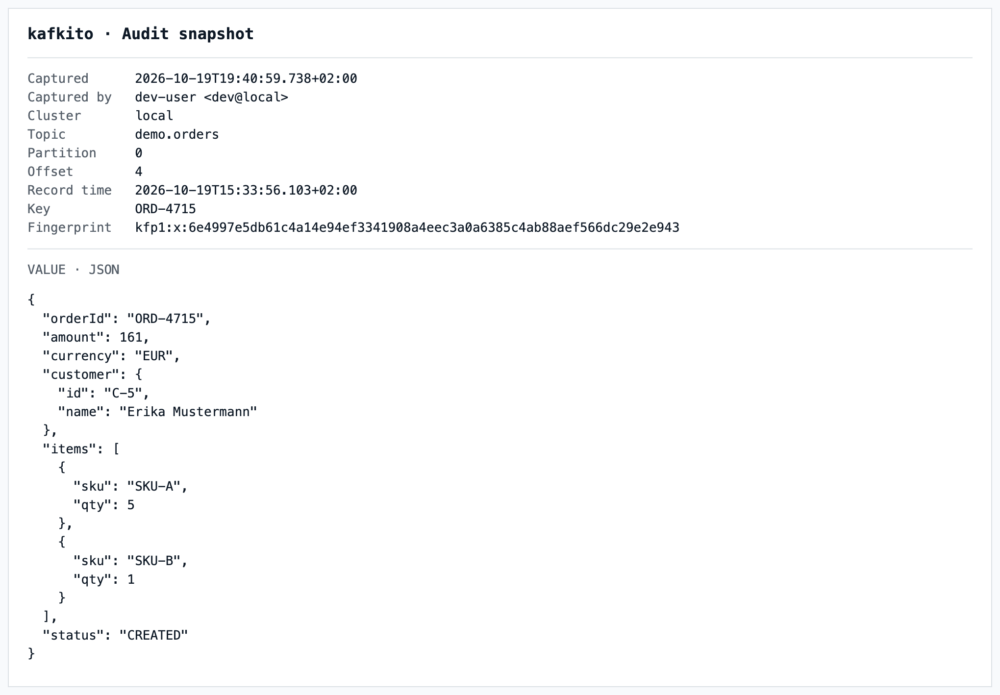

# Typical UI workflows

## Workflow 1: Find a message in a topic

**What do I see?**  
In the topic **Messages** tab: partition, start-point, limit, range controls, and the **Search** panel.

**What can I do?**  
1. Open **Topics → Topic-Name → Messages**.  
2. Optionally scope partition, set `From` (`latest`, `oldest`, `offset`), and choose a range.  
3. Open **Search**.  
4. Use `Mode = Text contains` for quick searches, `Record key` or `Header` to compare the key or one header, or switch to `JSONPath`, `XPath`, or `JavaScript`.  
5. Enter search value and run **Search**.  
6. Use **Search more →** when scanning larger ranges.

**Examples: searching on two fields (UI)**

Use the UI controls (Mode / Path / Operator / Value) — no API calls needed for everyday use. Steps:

1. Open Topics → select topic → Messages → Search.
2. Set Mode to either `JavaScript` (recommended) or `JSONPath` (alternative).
3. Paste the expression below into the **Search value** field and click **Search**.

JavaScript (recommended — easiest for object checks):

- Mode: JavaScript
- Search value (paste exactly):

```js
// find unpaid invoices for CUST-123
parsed.type === 'invoice' && parsed.customerId === 'CUST-123' && parsed.status === 'UNPAID' && parsed.totalAmount > 1000 && parsed.currency === 'USD'
```

Why JS: the UI passes the parsed JSON object as `parsed`, so field access and boolean logic are straightforward. The UI will show matched records when the expression evaluates to true.

JSONPath (alternative — when you prefer path expressions):

- Mode: JSONPath
- Operator: exists
- Path (paste into Path field):

```text
$..[?(@.type=='invoice' && @.customerId=='CUST-123' && @.status=='UNPAID' && @.totalAmount>1000 && @.currency=='USD')]
```

XPath (for XML payloads):

- Mode: XPath
- Path: `/invoice/customerId`
- Operator: `=`
- Value: `CUST-123`

Use `//customerId` to match the element at any depth, or `/invoice/@status` for an attribute.

Header (one header by its key):

- Mode: Header
- Header key: `x-correlation-id` (type it, or press ↓ for the header keys of the loaded messages and how many of them carry each)
- Operator: `=`
- Value: `abc-123`

`exists` finds the messages that carry the header, `missing` those that do not. The header key matches exactly, case-sensitive.

Record key: Mode `Record key`, then an operator and a value, for example `regex` and `^ord-`.

From a message: expand it and click the key, or open its headers (**Headers · n**, collapsed by default) and click a header's key (records carrying that header) or value (that exact value), the same way you click a field in the JSON view. A masked header value is not clickable. The search panel opens filled in; **Undo** restores what you had typed before.

Test evidence: **Audit snapshot** on an expanded message downloads a PNG of the record with date, time, user, cluster and topic; see [Workflow 7](#workflow-7-capture-a-message-as-test-evidence-audit-snapshot).

Notes:
- JSONPath filters select nodes; use `exists` to match messages where the expression finds at least one node.
- JavaScript mode is more robust for complex predicates and has access to: `key`, `value` (raw string), `parsed` (JSON object or `null`), `headers`, `partition`, `offset`, `timestampMs`.
- For scripting and automation, the API endpoint is documented under the API reference: /API/#search — use that when you need curl/snippets or to integrate searches into scripts.


**When should I use this?**  
Use it to find specific IDs, header patterns, or payload fields in live or historical streams.

**Expected result**  
You get matching records with partition/offset/timestamp and can inspect payload immediately.



---

## Workflow 2: Check and narrow down consumer lag

**What do I see?**  
Under **Consumer groups**, you see a group list (`State`, `Members`, `Topics`, `Lag`) and a detail panel for selected group.

**What can I do?**  
1. Open **Consumer groups**.  
2. Filter by group ID or enable `Lag only`.  
3. Select a group to open details.  
4. In **Offsets**, compare `Offset`, `Log end`, and `Lag` per topic/partition.  
5. Jump to affected topic directly from detail links.

**When should I use this?**  
Use it when backlog grows or it is unclear whether lag is localized or widespread.

**Expected result**  
You can identify whether lag is global or concentrated in specific topics/partitions.



---

## Workflow 3: Understand offsets by cross-checking Messages

**What do I see?**  
In group detail, committed offsets per partition; in topic **Messages**, the `offset` start mode.

**What can I do?**  
1. In **Consumer groups**, open the affected group and note lagging partition/offset context.  
2. Open the linked topic and go to **Messages**.  
3. Set `From = offset` and enter the offset you want to inspect.  
4. Select matching partition (or `all` for broader comparison).  
5. Review records around that offset.

**When should I use this?**  
Use it when you need to translate lag numbers into concrete records before/after consumer position.

**Expected result**  
You can connect abstract lag metrics to specific message context for troubleshooting.

---

## Workflow 4: Set or reset committed consumer offsets

**What do I see?**  
In **Consumer groups** detail, you get the **Reset offsets…** action (enabled only for `Empty`/`Dead` groups) and a modal with strategy + partition selection.

**What can I do?**  
1. Open **Consumer groups** and select the target group.  
2. Ensure group state is `Empty` or `Dead` (otherwise reset is blocked).  
3. Click **Reset offsets…**.  
4. Choose `Topic` and `Strategy` (`earliest`, `latest`, `specific offset`, `timestamp`, `shift-by`).  
5. Select partitions to update.  
6. Review **Lag preview** before commit.  
7. Click **Commit reset** and confirm.

**When should I use this?**  
Use it when you intentionally need to replay, skip, or realign consumption for a group.

**Expected result**  
Committed offsets change for selected partitions and group lag is recalculated.



---

## Workflow 5: Check message volume over time (Timeline)

**What do I see?**  
In topic detail **Timeline**, you get a bar chart and time grid with approximate message counts per time slot.

**What can I do?**  
1. Open **Topics → Topic-Name → Timeline**.  
2. Select range preset (`Last 24 hours`, `Last 7 days`, `Last 30 days`).  
3. Optionally scope a specific partition.  
4. Inspect bars and the time grid to see when traffic peaked.

**When should I use this?**  
Use it to answer “when did traffic increase/decrease?” before digging into individual records.

**Expected result**  
You can quickly identify low/high traffic windows and correlate them with lag or incidents.



---

## Workflow 6: Compare two messages across topics or clusters

**What do I see?**  
The **Compare messages** page puts two records side by side: a verdict for
key, value and headers, a line diff, a header table and the metadata of both
records (timestamp, encodings, schema, size, fingerprint).

**What can I do?**  
1. Open a message in **Topics → Topic-Name → Messages** and click
   **Select for compare** at the top of the expanded message. A bar at the
   bottom of the page shows the selection from now on, also in other topics
   and clusters.
2. Open the other message (another offset, another topic, or a topic on
   another cluster) and click **Compare with selected**. The compare page
   opens with both messages.
   Alternatively click **Enter message B** in the bar and type the cluster,
   topic, partition and offset of message B, or paste a reference
   (`cluster/topic/partition/offset`, from **Copy reference** in the bar).
3. **Close** returns to the page you started the compare from; **Open in
   topic** next to each reference in the metadata table shows the message
   in its topic. **Clear** in the bar drops the selection.
4. Pick the view: **Semantic** compares JSON and XML in a canonical form (key
   and attribute order, whitespace, namespace prefixes and number notation
   such as `12.5` vs `12.50` do not count); **Exact** compares the content as
   stored. Optionally ignore JSON array order or XML element order.
5. Tick **Only differences** to hide unchanged lines, headers and metadata.
6. To check a message against a fingerprint (`kfp1:…`, from the metadata
   table of an earlier compare), paste it as message B.

**When should I use this?**  
Use it to verify that a replicated, copied or transformed record still carries
the same data, or to find the field that changed between two versions.

**Expected result**  
The verdict reads *Identical* (byte for byte), *Equivalent* (same data,
formatting or order differs), *Different* (with the changed lines) or
*Not comparable* (masking on one side, or only a 64 KB preview available).
Provenance headers kafkito adds on produce, replay and copy (`X-Kafkito-*`)
are ignored unless you untick the option.

Large values: up to 1 MB everything above applies. Between 1 MB and 4 MB the
value is compared exactly only (no semantic level, no semantic fingerprint).
Above 4 MB only the 64 KB preview is compared, and the verdict says so.





---

## Workflow 7: Capture a message as test evidence (Audit snapshot)

**What do I see?**

An expanded message in **Topics → Topic-Name → Messages** has an
**Audit snapshot** button in its action bar, next to **Replay to…** and
**Select for compare**.



**What can I do?**

1. Pick the cluster in the cluster switcher and open
   **Topics → Topic-Name → Messages**.
2. Find the record: set partition, `From` and range, or use **Search**
   (see [Workflow 1](#workflow-1-find-a-message-in-a-topic)).
3. Click the row to expand the message.
4. Click **Audit snapshot**. The browser downloads a PNG; nothing is stored
   on the server.
5. Attach the PNG to the test case, ticket or audit record.

The file is named
`kafkito-audit-<cluster>-<topic>-p<partition>-o<offset>-<YYYYMMDDTHHMMSS>.png`,
for example `kafkito-audit-local-demo.orders-p0-o4-20261019T194059.png`, so
several snapshots sort by cluster, topic and time in a folder.

**What is in the snapshot?**  



| Field | Content |
|---|---|
| **Captured** | Date and time of the click, with milliseconds and UTC offset |
| **Captured by** | User name and email of the signed-in user, `—` without authentication |
| **Cluster** | Cluster name as shown in kafkito, followed by `[PROD]` for production clusters. Broker addresses are never shown |
| **Topic**, **Partition**, **Offset** | Where the record is stored; together they identify it uniquely |
| **Record time** | Kafka timestamp of the record, with UTC offset |
| **Key** | Record key, `(no key)` if it has none |
| **Fingerprint** | `kfp1:x:<sha256>` over key, value and headers |
| **Note** | Only when it applies: masking, or a value shown as a preview |
| **Value** | The value, pretty-printed for JSON and XML |

Headers are not part of the image; they are covered by the fingerprint.

**Checking a snapshot later**

The fingerprint makes the image verifiable. Open **Compare** with the record
as message A (**Select for compare**, then **Enter message B**) and paste the
`kfp1:…` value from the image as message B. *Identical* confirms that the
record in Kafka still matches the snapshot byte for byte (see
[Workflow 6](#workflow-6-compare-two-messages-across-topics-or-clusters)).

**Good to know**

- The image is always light, also in dark mode, so it prints and files well.
- Times follow the **Timezone** setting in the user menu (`Local` or `UTC`);
  the UTC offset is always printed. The time in the file name is the
  browser's local time.
- The snapshot holds what the message row shows. Values changed by a
  `data_masking` rule stay masked and get a note. A value above 64 KB is
  shown as its preview with a note and the full size; the fingerprint then
  reads `— (reason)`, because it needs the complete value.
- Long values are wrapped at 120 characters and cut after 1500 lines; the
  image says how many lines are left out. Use **Copy value** or
  **Download raw** for the complete value.
- The fingerprint is computed in the browser and needs a secure context:
  kafkito served over HTTPS or on `localhost`.

**When should I use this?**  
Use it whenever a test, an acceptance or an audit needs proof that a
specific record was in a specific topic on a specific cluster at a given
time, for example as evidence for an auditor or for a test protocol.

**Expected result**  
A self-contained PNG that names cluster, topic, position, time and the
person who captured it, shows the value and carries a fingerprint to check it
against the live record.
